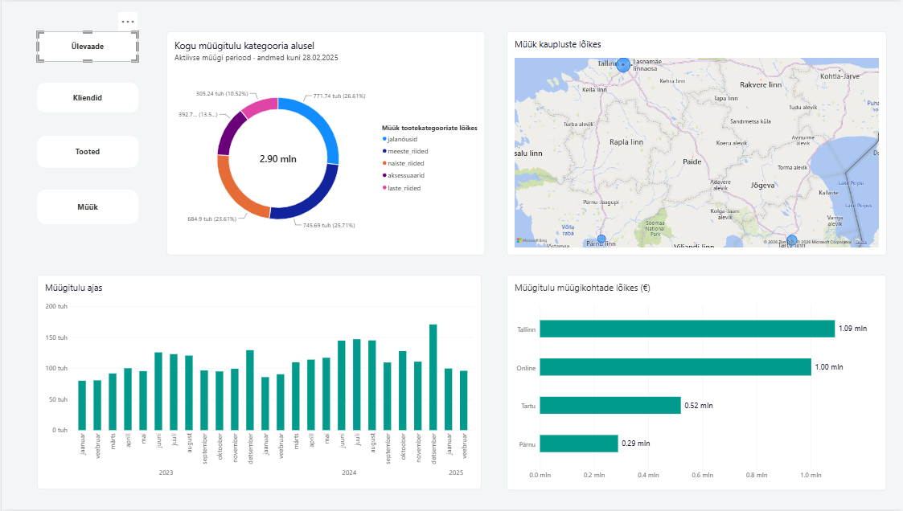
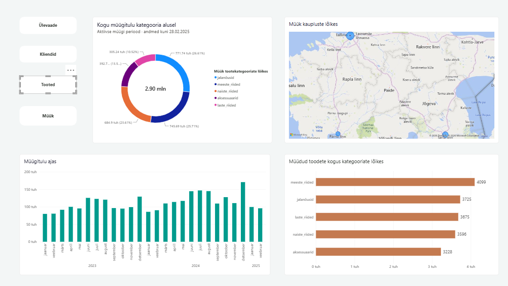
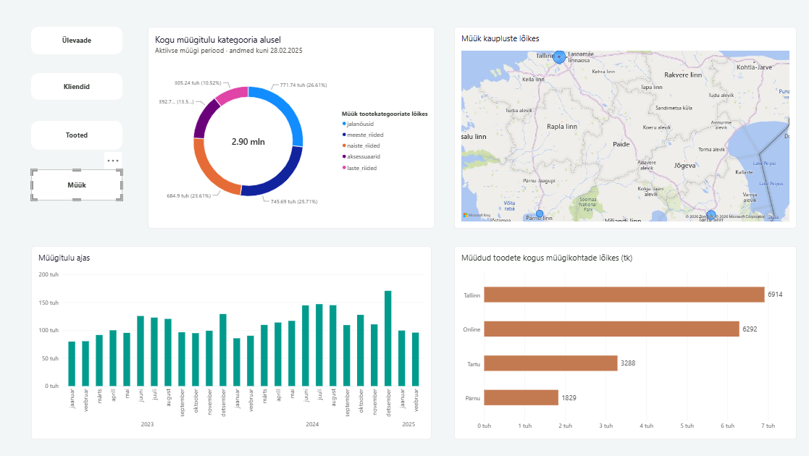

# SLAID 3: POWER BI – ANDMETEST VISUAALSE ÜLEVAATENI

**Esitaja:** Evelyn Uusmaa  
**Kestus:** kuni 2 minutit  
**Analüüsiperiood:** 01.01.2023–28.02.2025

## Põhisõnum

Power BI koondab müügiandmed interaktiivseks aruandeks,
kus saab võrrelda müügitulu, ostnud klientide arvu
ja müüdud toodete kogust.

Tallinn ja e-pood annavad suurima panuse nii müügitulusse
kui ka müüdud kogusesse. Jalatsid ja meesteriided
moodustavad kokku üle poole müügitulust.

## Peamised tulemused

| Näitaja | Tulemus |
|---|---:|
| Müügitulu kokku | ligikaudu 2,90 mln € |
| Tallinna müügitulu | ligikaudu 1,09 mln € |
| E-poe müügitulu | ligikaudu 1,00 mln € |
| Jalatsite ja meesteriiete osakaal müügitulust | ligikaudu 52,3% |
| Müüdud toodete kogus kokku | 18 323 tk |

Müügitulu ja osakaalud põhinevad aruandes kuvatud
ümardatud väärtustel.

## 1. Ülevaade

Ülevaade koondab neli graafikut:

- Müügitulu muutumine kuude kaupa.
- Müügitulu jaotus tootekategooriate vahel.
- Füüsiliste kaupluste asukohad ja müügitulu kaardil.
- Müügitulu võrdlus müügikohtade kaupa.

Tallinna müügitulu oli ligikaudu 1,09 miljonit
ja e-poe müügitulu 1,00 miljonit eurot.
Tartu müügitulu oli ligikaudu 0,52 miljonit
ning Pärnu müügitulu 0,29 miljonit eurot.

Tootekategooriatest andsid suurima osa müügitulust
jalatsid ja meesteriided: kokku ligikaudu 52,3%.

## 2. Kliendid

Klientide vaates näitab alumine diagramm ostnud
klientide arvu müügikohtade kaupa.

Andmesildid võimaldavad lugeda täpseid väärtusi
ja võrrelda, kui paljude ostnud klientideni
iga müügikoht jõudis.

Sama klient võib osta mitmest müügikohast.
Seetõttu ei saa müügikohtade klientide arve kokku
liita ja käsitleda tulemust ettevõtte unikaalsete
klientide koguarvuna.

## 3. Tooted

Toodete vaates näitab alumine diagramm müüdud
toodete kogust tootekategooriate kaupa.

See täiendab ülevaates olevat müügitulu jaotust.
Kogus näitab müüdud tükkide arvu, müügitulu aga
müügist saadud rahalist tulemust.

Neid näitajaid tuleb vaadata koos: suurema kogusega
kategooria ei pruugi anda suuremat müügitulu,
sest toodete hinnad on erinevad.

## 4. Müük

Müügi vaates näitab alumine diagramm müüdud
toodete kogust müügikohtade kaupa.

| Müügikoht | Müüdud kogus (tk) |
|---|---:|
| Tallinn | 6 914 |
| E-pood | 6 292 |
| Tartu | 3 288 |
| Pärnu | 1 829 |
| **Kokku** | **18 323** |

Kõige rohkem tooteid müüdi Tallinnas ja e-poes.
Sama järjestus ilmneb ka müügitulu võrdluses.

Ülevaate ja müügi vaated näitavad erinevaid mõõdikuid:
ülevaates võrreldakse müügikohti eurodes,
müügi vaates müüdud tükkide arvu järgi.

## Aruande interaktiivsus

Aruandes on neli navigeerimisnuppu:

- Ülevaade
- Kliendid
- Tooted
- Müük

Nupud on seotud järjehoidjatega, mis juhivad
diagrammide nähtavust samal aruandelehel.

Ühised graafikud jäävad nähtavale ning alumine
parempoolne diagramm vahetub vastavalt valitud teemale.

Andmesildid näitavad väärtusi otse graafikul.
Kohtspikrid võimaldavad vaadata täiendavat infot.

## Järeldused ja soovitused

### Tallinn ja e-pood on suurimad müügikohad

Mõlemad annavad suurima panuse nii müügitulusse
kui ka müüdud kogusesse.

Edasises analüüsis tasub võrrelda nende keskmist
müügihinda toote kohta ning ostude ja klientide arvu,
et mõista paremini müügitulemuste kujunemist.

### Jalatsid ja meesteriided annavad üle poole müügitulust

Nende kategooriate tulemused mõjutavad oluliselt
ettevõtte kogumüüki.

Tasub lähemalt uurida nende kaupade saadavust,
marginaale ja müügi muutumist ajas.

### Tartu ja Pärnu väiksem müügimaht vajab lisakonteksti

Väiksem müük ei tõesta iseenesest halvemat tulemuslikkust.
Võrdluses tuleb arvestada näiteks kaupluse suurust,
külastatavust, sortimenti ja tegevuskulusid.

Üksnes müügitulu ja koguse põhjal ei saa hinnata
kaupluste kasumlikkust.

## Andmete tõlgendamine ja piirangud

- Aruanne hõlmab perioodi kuni 28.02.2025.
- 2025. aasta sisaldab ainult jaanuari ja veebruari
  ning ei ole otse võrreldav varasemate täisaastatega.
- Müügitulu esitatakse eurodes, müüdud kogus tükkides
  ja ostnud klientide arv unikaalsete klientidena
  vastavas müügikohas.
- Sama klient võib esineda mitme müügikoha klientide seas.
- Kaupluste kaart hõlmab füüsilisi kauplusi.
  E-pood on kaasatud müügikohtade võrdlusdiagrammidesse.
- Aruandes kuvatud müügitulu on ümardatud.
  Ümardatud väärtuste summa võib kogusummast veidi erineda.
- Aruanne kirjeldab müügitulemusi;
  erinevuste põhjuste selgitamiseks on vaja lisaanalüüsi.

## Artefaktid

[Laadi alla Power BI aruanne](UrbanStyle_week10.pbix)

Interaktiivseks kasutamiseks laadi PBIX-fail alla
ja ava Power BI Desktopis.

Ülal kuvatud PNG-pildid on staatilised eelvaated.
Neil navigeerimisnupud ja kohtspikrid ei tööta.

## Seos grupitööga

**SQL:** andmete ettevalmistamine ja äriliste leidude tuvastamine.

**Power BI:** tulemuste visualiseerimine ja interaktiivne uurimine.

**Python:** analüüsi kordamine ja aruandluse automatiseerimine.

Power BI osa ühendab andmetest leitud tulemused
visuaalse ülevaatega, mis aitab esitada juhtimisküsimusi
ja suunata edasist analüüsi.
