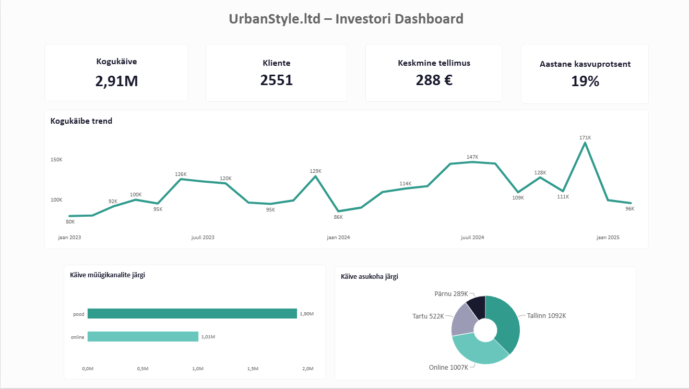

## MEESKOND: Sales Analytics  |  NÄDAL: 5 |  TEGELANE: Kristi Tamm, Anna Mets, Liis Koppel

---

## 👥 Meeskonnaliikmed

| Nimi | Roll (Nädal 5) | OS |
|---|---|:---:|
| Evelyn Uusmaa | A: [CEO + Operations]() | 🪟 Win |
| Nele Kund | B: [Marketing + Koondvaade](marketing-dashboard.md) | 🪟 Win |
| Andres Assuküll | C:   | 🍎 Mac |

---

## 📊 UrbanStyle dashboardide koondvaade

---

## Peamised leiud

### A: CEO Dashboard

UrbanStyle’i kogumüügitulu on **2,91 miljonit eurot** ning müügiandmetes on **2552 ostnud klienti**. Müügitulu kasvas 2024. aastal võrreldes 2023. aastaga **19,08%**, mis näitab ettevõtte positiivset arengut.

Kuupõhine müügitulu kõigub, kuid 2024. aasta üldine tase on varasemast kõrgem. Hilisemate perioodide andmete täielikkust tuleb enne juhtimisotsuste tegemist kontrollida.

➡️ [Vaata CEO Dashboardi](ceo-dashboard.md)

### B: Marketing Dashboard

Suurima käibega müügikanal on **Tallinna pood**, millele järgneb online-kanal. Uute klientide lisandumine kõigub kuude lõikes ning hilissuvel ja sügise alguses on näha korduvat vähenemist.

Turundustegevustes tasub pöörata tähelepanu online-kanalile ning tugevdada kampaaniaid perioodidel, mil uute klientide lisandumine väheneb.

➡️ [Vaata Marketing Dashboardi](marketing-dashboard.md)

### C: Operations

Tallinn on suurima müügituluga müügikoht, moodustades ligikaudu 37% kogumüügist, ning sellele järgneb väga lähedalt online-kanal. Pärnu müügitulu on kõige väiksem, mistõttu tasub hinnata sealse poe müügitulemusi ja tegevusmahtu.

Kõige suurem laoseis on meeste riiete kategoorias, samas kui kõige väiksem laoseis on aksessuaaridel. Väiksema laoseisuga kategooriate puhul tuleb võrrelda laokoguseid müügikiiruse ja tellimispunktidega, et vältida kaupade lõppemist.

### D: Investori kokkuvõte

UrbanStyle'i aastane kasv on **19%** (2023 → 2024). Kasvu toetab online-müügi ja füüsiliste poodide kombinatsioon. Suurima käibega on Tallinna pood **(1,09 mln €)**, millele järgneb vaid väikese vahega e-pood **(1,01 mln €)**
 
**Soovitus:** Suurendada turundustegevusi augustis-septembris ja alustada varakult aastalõpukampaaniatega.

### E: UrbanStyle’i müügiandmete valideerimise kokkuvõte

Esialgne valideerimine kinnitab, et UrbanStyle’i müügiandmete kogukäive on **2,91 miljonit eurot** ning 2024. aasta käive kasvas võrreldes 2023. aastaga **19,08%**, ulatudes 1,47 miljoni euroni. Suurima käibega müügikoht on Tallinn 1,09 miljoni euroga, millele järgneb online-kanal ligikaudu 1,01 miljoni euroga. Füüsiliste poodide koondosakaal on 65,39% ja e-poe osakaal 34,61%.

Andmekvaliteedi kontroll tõi esile **195 negatiivse müügisummaga** rida, **988 puuduva kliendinumbriga** müügirida ning **501** rida, kus **müügisumma erineb koguse ja ühikuhinna korrutisest**. Viimase näitaja puhul tuleb esmalt eristada negatiivsete summade märgierinevust tegelikust arvutuslikust lahknevusest. Laoandmetes esineb **10 negatiivse** ja **7 nullkogusega** kirjet ning **226** kirjet, mille kogus jääb **alla tellimispunkti**.

**Soovitatavad järgmised sammud:** selgitada negatiivsete müügiridade tähendus, arvutada müügisumma lahknevused pärast tehingutüübi arvestamist uuesti, kontrollida laoandmete ajakohasust ning prioriseerida varude täiendamine müügikiiruse ja tellimispunktide alusel. Turunduse hooajalisuse ja 2025.–2026. aasta müügitrendi järeldused tuleks enne otsuste tegemist valideerida võrreldavate perioodide andmetega.

Kokkuvõttes on 2024. aasta müügikasv kinnitatud, kuid andmekvaliteedi probleemid vajavad lahendamist enne, kui kõiki tulemusi saab kasutada lõplike juhtimisotsuste alusena.
